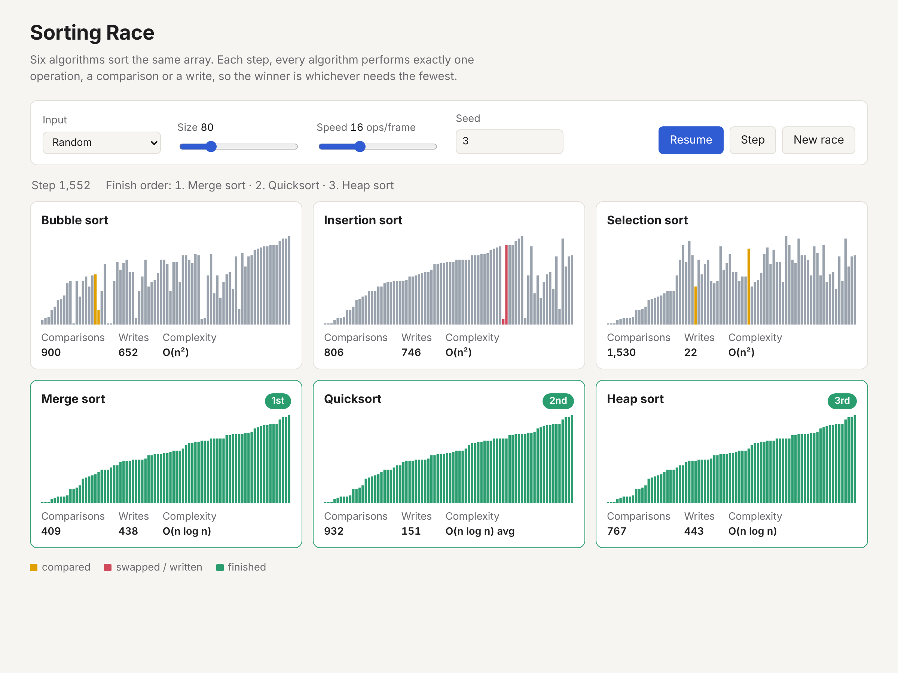

# frontend-sorting-race

Six sorting algorithms race on the same array in the browser. Every comparison and every write is counted, and each step gives every algorithm exactly one operation, so the finish order shows which algorithm needs the least work for that input.

**Live demo: https://ahmadelameer.github.io/frontend-sorting-race/**



## Problem

"Merge sort is O(n log n), insertion sort is O(n²)" is easy to memorize and hard to *feel*. Big-O also hides the cases that matter in practice:
- Insertion sort beats every O(n log n) algorithm on nearly sorted data.
- Selection sort barely writes to memory.
- Quicksort's speed depends on how it picks a pivot.

This project makes those differences visible and measurable. The animation is driven by the same instrumented code that produces the operation counts, and the tests prove the two can't drift apart.

## Overview

- `src/sorts.js`: bubble, insertion, selection, merge, quick and heap sort, each written as a **generator**. A generator yields one `{type, i, j}` operation every time the algorithm compares or writes, so it can be paused after any single step.
- `src/race.js`: seeded inputs (random, nearly sorted, reversed, few unique) and the `Race` engine. Each `tick()` advances every unfinished algorithm by exactly one operation.
- `src/ui.js`: draws each algorithm's array on a `<canvas>`, highlighting the last comparison or write, and runs the race on `requestAnimationFrame`.
- `scripts/bench.mjs`: the same engine in Node, printing operation counts for every algorithm and input.

No framework, no build step, no dependencies: plain HTML, CSS and ES modules.

## Key features

- Six algorithms racing side by side, with live comparison and write counters and a finish order. Algorithms that finish on the same step share a place.
- Four input shapes, sizes 10–300, and a seed, so any race can be repeated exactly. A race can also be set by URL, e.g. `?input=reversed&size=100&seed=7`.
- Speed from 1 to 4,096 operations per frame, plus Pause and single **Step**.
- Light and dark themes following the system setting. Responsive down to phone width, keyboard-focusable controls, screen-reader labels on each chart, and a live region announcing the finish order.
- Quicksort uses a median-of-three pivot and Hoare partitioning, so sorted and reversed inputs don't trigger its O(n²) worst case.

## Tech stack

- HTML, CSS, JavaScript (ES modules, generators, Canvas 2D)
- Node.js 20+ built-in test runner (`node:test`) for unit tests
- Playwright with Chromium for end-to-end browser tests and screenshots

## Architecture

```
 sorts.js  ── generator per algorithm ──►  yields {type: "compare" | "swap" | "write", i, j}
                                                  │
 race.js   Race: one lane per algorithm,          │  tick(): next() on every unfinished lane
           each with its own copy of the input ◄──┘  → counts compares / writes, records finish place
                                                  │
 ui.js     requestAnimationFrame loop:            │
           N × race.tick(), then draw each lane ◄─┘  bars on <canvas>, last op highlighted
```

Why generators? A sorting algorithm is naturally written as nested loops, and the UI needs to stop it after any single operation. A generator keeps the loops readable, with `yield` exactly where the work happens, and pausing is just not calling `next()`. Recursive algorithms (merge, quick) use `yield*` to pass operations up from nested calls.

The animation never inspects the algorithm's internals: it only sees the yielded operations. So the operations must describe every change to the array exactly. A test replays them on a copy of the input and checks the result is identical to the sorted array, for every algorithm and 150+ test arrays.

## Installation

Nothing to install. ES modules don't load from `file://`, so serve the folder:

```bash
git clone https://github.com/AhmadElAmeer/frontend-sorting-race.git
cd frontend-sorting-race
python3 -m http.server 8000      # or: npm run serve
# open http://localhost:8000
```

## Usage

- Pick an input, size and seed, then press **Start**. Press **Pause**, **Step** or **New race** at any time.
- Yellow bars were just compared, red bars were just written or swapped, and a lane turns green when it's finished.
- To compare the algorithms without the animation:

```bash
node scripts/bench.mjs 1000 1        # size 1000, seed 1
```

## Results

`node scripts/bench.mjs 1000 1`. Counts are deterministic, so this table is exact:

```
algorithm                                   Random                     Nearly sorted                          Reversed                        Few unique
Bubble sort        498,174 + 244,338 = 742,512 (6)            2,994 + 44 = 3,038 (2)   499,500 + 499,500 = 999,000 (5)   478,385 + 193,602 = 671,987 (6)
Insertion sort     245,335 + 244,338 = 489,673 (4)            1,043 + 44 = 1,087 (1)   499,500 + 499,500 = 999,000 (5)   194,600 + 193,602 = 388,202 (4)
Selection sort         499,500 + 992 = 500,492 (5)        499,500 + 44 = 499,544 (6)       499,500 + 500 = 500,000 (4)       499,500 + 810 = 500,310 (5)
Merge sort              8,731 + 9,332 = 18,063 (1)         4,956 + 4,975 = 9,931 (3)        5,044 + 9,976 = 15,020 (2)        8,205 + 8,606 = 16,811 (1)
Quicksort              15,375 + 2,766 = 18,141 (2)          14,007 + 44 = 14,051 (4)         13,973 + 502 = 14,475 (1)       14,967 + 4,239 = 19,206 (2)
Heap sort              16,840 + 9,083 = 25,923 (3)       17,567 + 9,692 = 27,259 (5)       15,965 + 8,316 = 24,281 (3)       14,316 + 7,354 = 21,670 (3)
```

Each cell is comparisons + writes = total, with the finish place in brackets.

What the numbers show:

- **There is no single winner.** Merge sort won on random and few-unique input, quicksort on reversed input, and insertion sort on nearly sorted input.
- **Insertion sort on nearly sorted data needed 1,087 operations,** about 9× fewer than merge sort, the fastest O(n log n) algorithm there. Its work is proportional to the number of out-of-place pairs, and there were only 44. That's why real library sorts (Timsort, introsort) switch to insertion sort for small or nearly ordered runs.
- **Selection sort always makes exactly 499,500 comparisons** (n(n−1)/2), whatever the input. But it never makes more than n − 1 swaps (at most 992 writes here), the fewest of any algorithm on random data. It's the right choice only when writes are very expensive.
- **Merge sort and quicksort finished within 0.5% of each other on random input** (18,063 vs 18,141). Merge sort makes fewer comparisons; quicksort makes far fewer writes (2,766 vs 9,332), because it swaps in place instead of copying through a buffer.
- **Bubble and insertion sort tie exactly on reversed input:** both do one comparison and one swap per pair, 999,000 operations.

This race counts operations, not wall-clock time. Real speed also depends on caches and memory access patterns, which is one reason quicksort typically beats heap sort in practice by more than this table shows.

## Testing

```bash
npm test          # 25 unit tests (node:test)
npm run test:ui   # 3 browser tests (needs Playwright with Chromium)
```

- **Correctness:** every algorithm against `Array.prototype.sort` on 158 arrays: empty, one element, duplicates, sorted, reversed and random.
- **Operation replay:** applying the yielded operations to a copy of the input reproduces the algorithm's result exactly. This is what guarantees the animation shows what the algorithm really did.
- **Known counts:**
  - selection sort makes n(n−1)/2 comparisons;
  - bubble and insertion sort make n − 1 comparisons and no writes on sorted input;
  - insertion sort makes one swap per inversion;
  - merge sort stays within n⌈log₂ n⌉ comparisons;
  - quicksort stays far below O(n²) on sorted and reversed input of 2,000 elements.
- **Stability:** merge, insertion and bubble sort keep equal keys in their original order.
- **Race engine:** lanes get separate copies of the input, every unfinished lane does exactly one operation per tick, finish places follow total work, and ties share a place.
- **In a real browser:**
  - a full race's on-screen counters and places match the Node engine for the same seed, with no console errors;
  - **Step** advances exactly one operation;
  - changing the input resets the race;
  - the page has no horizontal scroll at 375 px phone width.

To check that the tests can fail, nine bugs were planted one at a time:

- merge sort made unstable;
- insertion sort made unstable;
- bubble sort without its early exit;
- merge sort reporting the wrong write position;
- heap construction skipping a node;
- quicksort with a naive first-element pivot;
- lanes sharing one array;
- tied lanes getting different places;
- the UI showing the wrong counter.

All nine are caught. The first version of the stability test was itself broken: it used values that were all distinct, so it couldn't detect instability, and the unstable merge sort got through. It now sorts objects with repeated keys.

## Design decisions and challenges

- **A fair race.** If each algorithm ran at full speed, the winner would depend on the browser. Instead, one tick gives every algorithm one operation, so finish order measures only the amount of work.
- **Comparisons and writes cost the same here.** That's a simplification. In real systems a write to slow memory can cost more than a comparison, and selection sort's tiny write count would matter more. Both counts are shown so you can judge.
- **Merge sort needs a buffer.** It merges from copies of the two halves and reports each placement as a `write`. Its comparison positions point at the slots being merged, which is accurate enough to highlight but not a literal array read. Only the writes need to be exact, and the replay test checks those.
- **Seeded randomness.** `Math.random` can't be seeded, so a small PRNG (mulberry32) generates the inputs. The same seed gives the same race in the browser, in Node and in the tests, which is how the browser test can check the on-screen numbers.
- **Canvas instead of DOM bars.** Up to 300 bars × 6 lanes redrawn every frame would be 1,800 DOM elements to update. A canvas redraw is cheaper, and the canvas is sized for the screen's pixel density so it stays sharp.

## Future improvements

- More algorithms: shell sort, Timsort-style run merging, radix sort (which makes no comparisons at all).
- Let the user weight writes against comparisons, to see how the ranking changes when writes are expensive.
- A wall-clock mode that runs each algorithm on typed arrays at full speed, to compare real time with operation counts.
- Sound: map each operation's value to a pitch.

## What this project teaches

- How six classic sorting algorithms really behave, beyond their Big-O, and on which inputs each one shines.
- JavaScript generators and `yield*` as a way to turn an algorithm into something that can be paused and stepped.
- Canvas rendering and a `requestAnimationFrame` loop.
- Writing UI code that is testable: logic in DOM-free modules, tested in Node, plus a small set of real-browser tests.
- Accessible, responsive front-end basics: labels, focus styles, live regions, dark mode and a phone layout.

## License

MIT — see [LICENSE](LICENSE).
